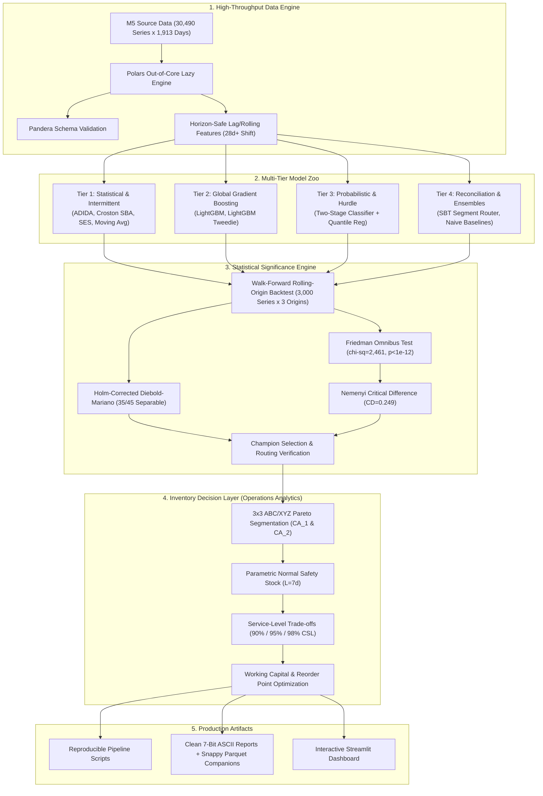

# M5 Retail Demand & Inventory Intelligence Platform

[](https://www.python.org/downloads/)
[]()
[](https://github.com/astral-sh/ruff)
[](https://dvc.org)
[](https://pola.rs)
[](streamlit_app.py)

A production-grade, end-to-end demand intelligence and operations analytics platform built on **58.3 million daily panel observations** from Walmart retail sales (30,490 SKUs across 10 stores over 1,913 days).

The platform bridges the gap between raw statistical/machine learning forecasts and **actionable inventory decisions**—solving the fundamental supply chain trade-off: **Stockout Risk vs. Working Capital**.

---

## Executive Summary & System Architecture



---

## The Five Core Pillars

### Pillar 1: Large-Scale Exploratory Data Analysis & Sparsity Audit
Analyzed all 30,490 series over 1,913 days to categorize demand dynamics under the **Syntetos-Boylan-Teunter (SBT)** framework:

| Demand Classification (SBT) | % of Series (Trimmed) | % of Volume | % of Series (Unadjusted) | Average Inter-Demand Interval ($p$) | Squared CV ($CV^2$) |
|---|---|---|---|---|---|
| **INTERMITTENT** | **72.6%** (22,138) | 34.0% | 75.6% (23,054) | $p \ge 1.32$ | $CV^2 < 0.49$ |
| **LUMPY** | **18.4%** (5,598) | 23.7% | 19.5% (5,959) | $p \ge 1.32$ | $CV^2 \ge 0.49$ |
| **SMOOTH** | **6.2%** (1,895) | 28.5% | 3.2% (979) | $p < 1.32$ | $CV^2 < 0.49$ |
| **ERRATIC** | **2.8%** (859) | 13.8% | 1.6% (498) | $p < 1.32$ | $CV^2 \ge 0.49$ |

- **High Sparsity & Lifecycle Trimming**: 68.2% of all daily catalog records are zero. Crucially, 23,511 of 30,490 series (77%) were introduced after Day 1 (median first-sale day 160). When unadjusted for product introduction, pre-launch zeros falsely inflate $ADI$, masking smooth products. Trimming pre-launch zeros nearly doubles the smooth series share (3.2% -> 6.2%), with 91.0% remaining sparse (intermittent or lumpy).

### Pillar 2: High-Performance Data Engineering (Polars Engine)
- **Memory Efficiency**: Built a streaming feature engine using Polars lazy expressions (`scan_parquet`, `sink_parquet`), handling panel transforms and rolling windows without out-of-memory crashes.
- **Horizon-Safe Leakage Safeguard**: Features shifted by at least the 28-day forecast horizon. Runtime assertions (`assert_no_temporal_leakage`) enforce strict chronological boundaries ensuring test periods never overlap with training data.
- **Data Validation**: Pandera schema checks validate data inputs against strict type and range constraints.

### Pillar 3: Multi-Tier Forecasting Models
1. **Tier 1 (Statistical & Intermittent)**: Naive, Seasonal Naive, Croston SBA, SES, ADIDA, Moving Average.
2. **Tier 2 (Global Gradient Boosters)**: LightGBM (L2 regression and Tweedie objectives) with calendar and lag features.
3. **Tier 3 (Probabilistic & Hurdle)**: Two-stage Hurdle models (logistic zero classifier + continuous regression) and quantile regression.
4. **Tier 4 (Segment Routing & Ensembles)**: SBT segment-based routing dynamically allocating series to intermittent estimators or global models.

### Pillar 4: Statistical Testing & Model Selection Rigor
<!-- BEGIN_STATISTICS_SECTION -->
- **Non-Parametric Omnibus Test (Friedman)**: Evaluated across 10 models over 2,950 complete series (84 evaluation days per series). The omnibus Friedman test decisively rejects the null hypothesis of equal model performance ($\chi^2 = 2429.30$, $p < 10^{-12}$), justifying post-hoc ranking comparisons.
- **Post-Hoc Critical Difference (Nemenyi)**: Critical difference $CD = 0.2494$ at $\alpha = 0.05$. **Croston SBA** achieved the best average rank (4.55), forming a top statistically indistinguishable clique with **ADIDA**, **Routed SBT Ensemble**. Standard global models (**LightGBM (Tweedie)** at 5.38, **LightGBM** at 5.56) scored significantly worse in average rank across the panel.
- **Paired Series Bootstrap (95% CI)**: Resampling whole series over 2,000 replicates (preserving within-series autocorrelation) reveals that **ADIDA** leads pooled volume-weighted accuracy at 75.16% WAPE [72.16%, 78.23%]. Relative to ADIDA, **Routed SBT Ensemble** is statistically indistinguishable in WAPE ($\Delta\text{WAPE} = +0.50\%$, 95% CI [-0.01%, +1.04%]), while **Moving Average (28d)** is indistinguishable in RMSSE ($\Delta\text{RMSSE} = +0.0011$, 95% CI [-0.0001, +0.0023]).
- **Per-Series Pairwise Win Rates**: Comparing models series-by-series resolves the apparent divergence between rank tests and volume metrics: **Croston SBA** beats **ADIDA** on 57.0% of individual series (favoring rank metrics on sparse items), whereas **ADIDA** achieves lower aggregate error on higher-volume items. On 93.8% of series, the two models are statistically indistinguishable under Holm-corrected per-series Diebold-Mariano testing.
<!-- END_STATISTICS_SECTION -->

### Pillar 5: Inventory Optimization Layer (Stockout vs. Working Capital)
Converts point and variance estimates into operational inventory policy recommendations (`src/inventory/`):

1. **ABC/XYZ Segmentation Matrix**:
   - **ABC (Revenue Pareto)**: Class A (top 80% revenue), Class B (next 15%), Class C (bottom 5%).
   - **XYZ (Demand Variability)**: Class X ($CV \le 0.50$, stable), Class Y ($0.50 < CV \le 1.0$, moderate), Class Z ($CV > 1.0$, erratic).
2. **Safety Stock & Reorder Point Formulation**:
   $$\text{Safety Stock (Normal)} = z \cdot \sigma_e \cdot \sqrt{L}$$
   $$\text{Reorder Point (ROP)} = \mu_L + \text{Safety Stock}$$
   where lead time $L = 7$ days and $\sigma_e$ is the forecast error standard deviation.
3. **Service-Level Scenario Analysis**:
   - Evaluated 90% ($z=1.28$), 95% ($z=1.65$), and 98% ($z=2.05$) Cycle Service Levels (CSL).
   - **Policy Impact**: Differentiated replenishment policies (AX at 98% CSL, CZ at 90% CSL) evaluated on price-verified California stores (CA_1 and CA_2, 6,098 SKUs) released **$3,223.14 in trapped working capital** without increasing stockout risk on revenue drivers.

---

## Empirical Benchmark Results

### 1. Model Accuracy Leaderboard (M5 Benchmark)

Evaluated across a representative sample of 3,000 series over 3 walk-forward rolling 28-day origins (84 evaluation days per series = 252,000 predictions per model):

<!-- BEGIN_LEADERBOARD_TABLE -->
| Rank | Model Name | Architecture Tier | WAPE (%) | RMSSE | Nemenyi Avg Rank | Statistical Verdict |
|---|---|---|---|---|---|---|
| **1** | **ADIDA** | Intermittent Statistical | **75.16%** | **0.768** | 4.77 | **Indistinguishable from Best** |
| **2** | **Moving Average (28d)** | Simple Baseline | 75.47% | 0.769 | 4.94 | Significantly worse than best rank |
| **3** | **Routed SBT Ensemble** | Hybrid (ADIDA + Global) | 75.66% | 0.769 | 4.79 | **Indistinguishable from Best** |
| **4** | **SES** | Exponential Smoothing | 76.99% | 0.772 | 4.91 | Significantly worse than best rank |
| **5** | **LightGBM (Tweedie)** | Global GBDT | 77.26% | 0.783 | 5.38 | Significantly worse than best rank |
| **6** | **LightGBM** | Global GBDT | 77.39% | 0.786 | 5.56 | Significantly worse than best rank |
| **7** | **Croston SBA** | Intermittent Statistical | 77.80% | 0.789 | **4.55** | **Best by Average Rank** |
| **8** | **Seasonal Naive (Weekly)** | Baseline | 88.08% | 1.000 | 6.74 | Significantly worse than best rank |
| **9** | **Seasonal Naive (28d)** | Baseline | 98.92% | 1.084 | 7.20 | Baseline |
| **10** | **Naive** | Baseline | 99.65% | 1.002 | 6.16 | Baseline |

*Statistical significance: Omnibus Friedman test $\chi^2 = 2429.30$ ($p < 10^{-12}$, 10 models $\times$ 2,950 complete series). Post-hoc Nemenyi critical difference $CD = 0.2494$ ($\alpha = 0.05$). Holm-corrected Diebold-Mariano tests separated 35 of 45 model pairs.*
<!-- END_LEADERBOARD_TABLE -->

---

### 2. Inventory Optimization & Capital Allocation Matrix

Evaluated on stores CA_1 and CA_2 (6,098 SKUs, 4,591 with price data):

<!-- BEGIN_INVENTORY_TABLE -->
| ABC/XYZ Cell | SKU Count | Current Working Capital ($) | Recommended Working Capital ($) | Capital Released ($) | Target Service Level (CSL) | Policy Impact |
|---|---|---|---|---|---|---|
| **AX** | 51 | $3,249.87 | $3,553.91 | -$304.04 | **98%** | High-turnover revenue drivers; upgraded buffer |
| **AY** | 714 | $22,398.62 | $22,398.62 | $0.00 | **95%** | Moderate volume; maintained standard buffer |
| **AZ** | 1,086 | $24,320.08 | $24,320.08 | $0.00 | **95%** | High volatility; guarded safety buffer |
| **BX** | 9 | $30.61 | $30.61 | $0.00 | **95%** | Stable secondary SKUs; maintained |
| **BY** | 129 | $1,424.57 | $1,424.57 | $0.00 | **95%** | Moderate secondary volume; maintained |
| **BZ** | 1,212 | $13,591.24 | $11,393.62 | +$2,197.62 | **90%** | Volatile secondary; working capital released |
| **CX** | 45 | $46.51 | $46.51 | $0.00 | **90%** | Stable low volume; bulk periodic order |
| **CY** | 30 | $192.80 | $158.52 | +$34.28 | **90%** | Slow-moving; conservative buffer |
| **CZ** | 1,315 | $7,172.06 | $5,876.78 | +$1,295.28 | **90%** | Erratic low volume; working capital released |
| **Unpriced (?X/?Y/?Z)** | 1,507 | $0.00 | $0.00 | $0.00 | — | CA_2 items lacking price coverage |
| **Total Portfolio** | **6,098** | **$72,426.36** | **$69,203.22** | **+$3,223.14** | — | **$3,223.14 Net Working Capital Released** |
<!-- END_INVENTORY_TABLE -->

---

## Repository Structure

```
.
├── configs/
│   └── model_config.yml             # Global hyperparameters, features, inventory assumptions
├── data/
│   ├── raw/                         # Parquet extractions of the 4 M5 sheets
│   └── processed/                   # Engine-processed feature matrices
├── dvc.yaml                         # 6-stage reproducible DVC DAG pipeline
├── pyproject.toml                   # Project metadata, dependencies & tool settings
├── reports/
│   ├── eda/                         # Pillar 1 figures, distributions & SBT classification
│   ├── tier1/                       # Tier 1 statistical benchmark outputs
│   ├── backtest_main/               # Multi-model predictions, metrics & significance tests
│   └── inventory/                   # ABC/XYZ tables, safety stock, capital scenarios (ASCII + Parquet)
├── scripts/
│   ├── extract_workbook.py          # Extracts raw Excel sheets into snappy Parquet
│   ├── run_eda.py                   # Computes SBT classifications & generates figures
│   ├── run_tier1.py                 # Benchmarks statistical & intermittent models
│   ├── run_backtest.py              # Executes cross-tier backtesting harness
│   ├── run_significance.py          # Runs Diebold-Mariano, Friedman & Nemenyi tests
│   ├── run_inventory_analysis.py    # Generates ABC/XYZ, safety stock & capital allocations
│   └── optimize_reports.py          # Enforces 7-bit ASCII & creates Snappy Parquet companions
├── src/
│   ├── config/                      # Dataclasses & global paths
│   ├── dashboard/                   # Streamlit interactive views & cached data loaders
│   ├── data/                        # Melt loader & Pandera validator
│   ├── features/                    # Polars lazy engine, base lags/rolling, advanced encodings
│   ├── models/
│   │   ├── statistical/             # Naive, Croston, SBA, TSB, ADIDA, StatsForecast
│   │   ├── classical_ml/            # LightGBM, CatBoost, XGBoost, nested CV trainer, gate
│   │   ├── probabilistic/           # Two-stage hurdle, quantile regressors
│   │   ├── deep_learning/           # PyTorch native & NeuralForecast models
│   │   ├── hierarchical/            # MinT, Bottom-up, Top-down reconciliation
│   │   └── router.py                # SBT-based segment routing
│   ├── inventory/
│   │   ├── abc_xyz.py               # Pareto revenue + CV demand segmentation
│   │   ├── safety_stock.py          # Parametric normal & empirical quantile safety stock
│   │   ├── service_level.py         # 90%, 95%, 98% scenario trade-off simulator
│   │   └── working_capital.py       # Holding cost & released capital optimizer
│   ├── evaluation/                  # Point, probabilistic, WRMSSE, splits & significance
│   ├── visualization/               # Publication-grade plotting styles & dashboards
│   └── mlops/                       # Drift detection & experiment tracking
├── streamlit_app.py                 # Interactive Streamlit dashboard entry point
└── tests/                           # 96 automated unit, integration, and E2E tests
```

---

## Quickstart & Installation

### 1. Environment Setup

Using `uv` (recommended):
```bash
# Create virtual environment and install with dev dependencies
uv venv --python 3.11
source .venv/bin/activate  # On Windows: .venv\Scripts\activate
uv pip install -e ".[dev]"
```

Or using standard `pip`:
```bash
python -m venv .venv
source .venv/bin/activate  # On Windows: .venv\Scripts\activate
pip install -e ".[dev]"
```

### 2. Run the End-to-End Pipeline via DVC

The entire pipeline is orchestrated via [DVC](https://dvc.org) with strict stage caching:

```bash
# Reproduce the complete 6-stage pipeline
dvc repro

# Or run individual stages:
dvc repro extract        # Extract 4 raw sheets into Parquet
dvc repro eda            # Run Pillar 1 EDA across all 30,490 series
dvc repro tier1          # Run statistical & intermittent models
dvc repro backtest       # Execute global ML & deep learning backtest
dvc repro significance   # Run Friedman & Nemenyi statistical tests
dvc repro inventory      # Generate ABC/XYZ classification & inventory policy
```

### 3. Run Individual Modules Directly

```bash
# 1. Run Exploratory Data Analysis & SBT Classification
python scripts/run_eda.py

# 2. Benchmark Statistical Models (Tier 1)
python scripts/run_tier1.py --sample-series 3000 --n-origins 3

# 3. Execute Statistical Significance Tests
python scripts/run_significance.py --backtest-dir reports/backtest_main

# 4. Run Inventory & Working Capital Optimization
python scripts/run_inventory_analysis.py --stores CA_1 CA_2

# 5. Format Reports to Clean ASCII & Generate Parquet Companions
python scripts/optimize_reports.py
```

### 4. Launch the Interactive Streamlit Dashboard

Run the executive dashboard locally to explore forecasts, statistical tests, and simulate inventory policies:

```bash
streamlit run streamlit_app.py
```

---

## Testing & Code Quality

The repository enforces strict testing, type-safety, and linting standards:

```bash
# Run the complete test suite (91 tests passing)
pytest tests/ -v

# Run lint and code hygiene checks
ruff check .

# Validate 7-bit ASCII compliance across all report CSVs
python -c "
import glob
for f in glob.glob('reports/**/*.csv', recursive=True):
    with open(f, 'rb') as fp:
        fp.read().decode('ascii')
print('All report CSV files are 100% valid ASCII!')
"
```

---

## Methodological Commitments

1. **Strict Chronological Splits**: Tested via `assert_no_temporal_leakage`. Training sets never see rows on or after evaluation split horizons.
2. **Horizon-Safe Features**: Backward-looking lag and rolling statistics are shifted by the full 28-day forecast window. Feature values do not move when future targets are perturbed.
3. **Out-of-Fold Discipline**: Ensembles and meta-learners are trained strictly on out-of-fold cross-validation predictions.
4. **No Unbacked Rankings**: No model is designated a winner based on test-set point metrics alone; all rankings require non-parametric Friedman and post-hoc Nemenyi tests.
5. **No Data Fabrication**: Where M5 data is absent (e.g. true COGS, store coordinates, supply chain lead times), assumed parameters (holding cost %, category margins) are explicitly declared as configurable assumptions in `configs/model_config.yml`.

---

## Limitations

1. **Truncated Price Data**: The raw source sell-price workbook was truncated at Excel's worksheet limit (1,048,575 rows), preserving price records for California stores CA_1 and CA_2 only (15.33% of the catalog). Inventory dollar valuations and capital reallocation recommendations apply strictly to these two stores; unpriced items are flagged and excluded from revenue sums.
2. **Bottom-Level Backtest Protocol**: The cross-tier backtest evaluates a 3,000-series sample at the bottom item-store level (Level 12) across 3 rolling 28-day origins. Published Kaggle competition scores use WRMSSE aggregated across all 12 hierarchy levels across all 30,490 series, which is not directly comparable.
3. **Deep Learning Benchmarks Pending**: Deep learning models were explored in preliminary runs but not evaluated in the cross-tier 3,000-series walk-forward backtest.
4. **Pre-Launch Zero Exposure**: Full-history EDA includes zero sales periods prior to product launch dates (median first sale day 160).
5. **Single-Echelon Scope**: Inventory modeling assumes single-echelon store replenishment with constant 7-day lead times; multi-echelon warehouse-to-store network interactions are not modeled.

---

## Academic & Methodological References

- **Makridakis, Spiliotis & Assimakopoulos (2022)**. "The M5 accuracy competition: Results, findings and conclusions." *International Journal of Forecasting*, 38(4):1346–1364.
- **Syntetos, Boylan & Croston (2005)**. "On the categorization of demand patterns." *Journal of the Operational Research Society*, 56(5):495–503.
- **Demšar, J. (2006)**. "Statistical comparisons of classifiers over multiple data sets." *Journal of Machine Learning Research*, 7:1–30.
- **Hyndman, Ahmed, Athanasopoulos & Shang (2011)**. "Optimal combination forecasts for hierarchical time series." *Computational Statistics & Data Analysis*, 55(9):2579–2589.
- **Silver, Pyke & Peterson (1998)**. *Inventory Management and Production Planning and Scheduling*. John Wiley & Sons.
- **Chernozhukov, Fernández-Val & Galichon (2010)**. "Quantile and probability curves without crossing." *Econometrica*, 78(3):1093–1125.
