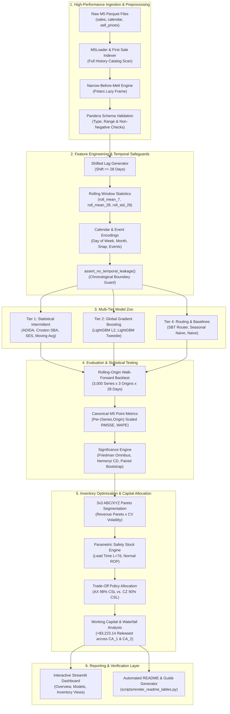

# 02: System Architecture & Component Design

This document details the modular software architecture, data pipelines, and end-to-end record lifecycle of the platform.

---

## 1. System Architecture & Component Data Flow

---

## 2. Component Responsibility Matrix

| Subsystem | Responsibility | Primary Inputs | Primary Outputs | Key Modules & Files |
| :--- | :--- | :--- | :--- | :--- |
| **Data Ingestion & Loading** | Scan raw Parquet sheets, detect first non-zero sale across day 1 onward, and melt wide catalog into narrow panel records without memory blowout. | Raw Parquets in `data/raw/` (`sales_train_validation`, `calendar`, `prices`) | Clean filtered Polars/Pandas panel DataFrames | [`src/data/loader.py`](../../src/data/loader.py) [`src/data/validator.py`](../../src/data/validator.py) |
| **Feature Engineering** | Generate direct multi-horizon features (lags, rolling means, seasonal calendar indicators) shifted by at least 28 days to prevent future leakage. | Melted panel data | Feature matrices with temporal assertions verified | [`src/features/polars_engine.py`](../../src/features/polars_engine.py) [`src/features/base.py`](../../src/features/base.py) |
| **Tier 1: Statistical Models** | Fast series-by-series intermittent demand estimation (Croston SBA, ADIDA, SES, Moving Average). | Raw historical sales series and active first-sale index | 28-day rate forecasts | [`src/models/statistical/intermittent.py`](../../src/models/statistical/intermittent.py) [`src/models/statistical/naive.py`](../../src/models/statistical/naive.py) |
| **Tier 2: Global Gradient Boosters** | Pooled LightGBM models trained on panel features optimizing regression L2 and Tweedie compound Poisson objectives. | Shifted feature matrices across training windows | 28-day point forecasts | [`src/models/classical_ml/trainer.py`](../../src/models/classical_ml/trainer.py) |
| **Tier 4: Routing & Baselines** | Classify series into SBT demand quadrants and route to specialized estimators (ADIDA for sparse, Global GBDT for smooth). Benchmark against Naive and Seasonal Naive. | Panel history & SBT classifications | Routed ensemble forecasts & baseline predictions | [`src/models/router.py`](../../src/models/router.py) [`src/models/statistical/naive.py`](../../src/models/statistical/naive.py) |
| **Backtesting & Evaluation Harness** | Execute walk-forward rolling-origin evaluation across 3 origins (84 days total), scoring each (series, origin) with its canonical in-sample scale. | Model point predictions & ground truth actuals | `accuracy_overall.csv`, `accuracy_by_origin.csv`, `predictions.parquet` | [`src/evaluation/backtest.py`](../../src/evaluation/backtest.py) [`src/evaluation/point_metrics.py`](../../src/evaluation/point_metrics.py) |
| **Statistical Significance Engine** | Run Friedman omnibus test, Nemenyi critical difference, per-series head-to-head win rates, and 2,000-replicate paired series bootstrap intervals. | `predictions.parquet` | `significance_report.json`, `critical_difference.png`, `bootstrap_intervals.csv` | [`src/evaluation/significance.py`](../../src/evaluation/significance.py) [`scripts/run_significance.py`](../../scripts/run_significance.py) |
| **Inventory Decision Layer** | Compute ABC/XYZ revenue Pareto and volatility matrices, calculate parametric safety stock, and optimize working capital trade-offs across service levels. | Forecast predictions, actual demand, and store sell prices | `portfolio_summary.csv`, `sku_policies.csv`, `service_level_tradeoff.png` | [`src/inventory/abc_xyz.py`](../../src/inventory/abc_xyz.py) [`src/inventory/safety_stock.py`](../../src/inventory/safety_stock.py) [`src/inventory/working_capital.py`](../../src/inventory/working_capital.py) |
| **Dashboard & Rendering** | Interactive Streamlit visualization reading canonical CSV artifacts, and automated in-place markdown table synchronization. | Report artifacts in `reports/` | Interactive UI at `streamlit_app.py` & verified README tables | [`src/dashboard/data_loader.py`](../../src/dashboard/data_loader.py) [`scripts/render_readme_tables.py`](../../scripts/render_readme_tables.py) |

---

## 3. The Life of a Record: End-to-End Walkthrough

To see how the platform functions in practice, consider the lifecycle of one single SKU record: **`FOODS_1_001_CA_1`** (a specialty food item in California Store 1):

1. **Catalog Ingestion & Lifecycle Trimming**:
   - `M5Loader.load_first_sale_dates()` scans the catalog history from Day 1 ($d_1$). It discovers `FOODS_1_001_CA_1` recorded its first non-zero sale on **Day 160**.
   - When loading the 900-day backtest training window (Days 986 to 1885), the loader notes that Day 160 predates Day 986, meaning the item is a mature product. All zeros inside the 900-day window are genuine low demand, and no in-window zeros are falsely trimmed.
2. **SBT Demand Profiling**:
   - `classify_demand()` evaluates the historical series. The item experiences an average inter-demand interval $ADI = 2.45$ days ($ADI \ge 1.32$) and a transaction variance $CV^2 = 0.31$ ($CV^2 < 0.49$).
   - The SKU is flagged as **INTERMITTENT**.
3. **Feature Generation**:
   - The Polars engine computes historical lags. For forecasting Day 1886 ($t+1$), the most recent sales feature used is strictly shifted by 28 days to Day 1858 ($t-28$). Runtime assertion `assert_no_temporal_leakage` passes.
4. **Model Forecasting**:
   - **Croston SBA**: Slices active non-zero sales, updates interval $\hat{p} = 2.45$ and demand size $\hat{z} = 2.10$, applying shrinkage $(1 - 0.1/2) \cdot (2.10 / 2.45) = 0.814$ units/day.
   - **ADIDA**: Aggregates daily demand into 2-day buckets, fits SES, and outputs $0.805$ units/day.
   - **LightGBM Tweedie**: Evaluates lag features and day-of-week indicators, predicting $0.782$ units/day.
   - **Router**: Detects the INTERMITTENT classification and routes the item to ADIDA.
5. **Rolling-Origin Evaluation**:
   - Across Origin 0 (Days 1886–1913), in-sample naive scale $s_i$ is computed from Day 986 to 1885 ($s_i = 1.42$).
   - Point errors $(y_{t} - \hat{y}_t)$ are scaled by $\sqrt{s_i}$ to compute $\text{RMSSE}_i = 0.742$ and absolute error for WAPE.
6. **Significance & Bootstrap Inclusion**:
   - The SKU's 84 evaluation days across 3 origins are logged into `predictions.parquet`.
   - In the paired bootstrap engine, the entire block of `FOODS_1_001_CA_1` is resampled with replacement, contributing to the 95% confidence intervals on model gaps.
7. **Inventory Optimization & Policy Output**:
   - Historical unit sales and store price ($sell_price = $2.24$) place the SKU in **Class B** (secondary volume) and **Class Y** (moderate variance).
   - Forecast error standard deviation $\sigma_e = 0.95$ units. With lead time $L = 7$ days:
     $$\text{Safety Stock} = 1.645 \times 0.95 \times \sqrt{7} \approx 4.13 \approx 5 \text{ units}$$
     $$\text{Reorder Point (ROP)} = (0.805 \times 7) + 5 = 5.63 + 5 \approx 11 \text{ units}$$
   - Maintained at 95% CSL, locking $5 \times \$2.24 = \$11.20$ in working capital buffer.
8. **Dashboard & Report Synchronization**:
   - Streamlit overview binds the resulting inventory KPI card dynamically, while `render_readme_tables.py` updates the public README without human intervention.
