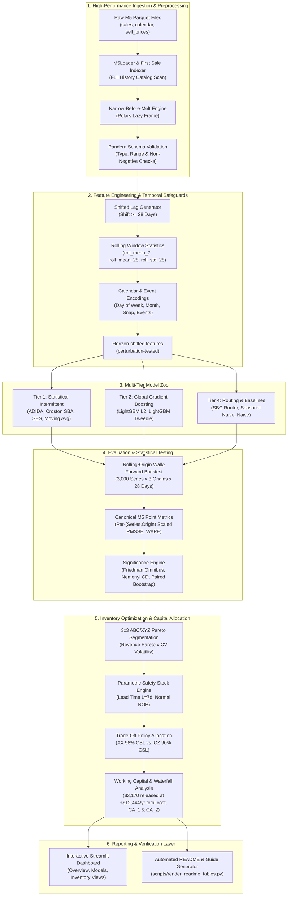

# 02: System Architecture & Component Design

This document details the modular software architecture, data pipelines, and end-to-end record lifecycle of the platform.

---

## 1. System Architecture & Component Data Flow

---

## 2. Component Responsibility Matrix

| Subsystem | Responsibility | Primary Inputs | Primary Outputs | Key Modules & Files |
| :--- | :--- | :--- | :--- | :--- |
| **Data Ingestion & Loading** | Scan raw Parquet sheets, detect first non-zero sale across day 1 onward, and melt wide catalog into narrow panel records without memory blowout. | Raw Parquets in `data/raw/` (`sales_train_validation`, `calendar`, `prices`) | Clean filtered Polars/Pandas panel DataFrames | [`src/data/loader.py`](../../src/data/loader.py) [`src/data/validator.py`](../../src/data/validator.py) |
| **Feature Engineering** | Generate direct multi-horizon features (lags, rolling means, seasonal calendar indicators) shifted by at least 28 days to prevent future leakage. | Melted panel data | Feature matrices with temporal assertions verified | [`src/features/polars_engine.py`](../../src/features/polars_engine.py) [`src/features/base.py`](../../src/features/base.py) |
| **Tier 1: Statistical Models** | Fast series-by-series intermittent demand estimation (Croston SBA, ADIDA, SES, Moving Average). | Raw historical sales series and active first-sale index | 28-day rate forecasts | [`src/models/statistical/intermittent.py`](../../src/models/statistical/intermittent.py) [`src/models/statistical/naive.py`](../../src/models/statistical/naive.py) |
| **Tier 2: Global Gradient Boosters** | Pooled LightGBM models trained on panel features optimizing regression L2 and Tweedie compound Poisson objectives. | Shifted feature matrices across training windows | 28-day point forecasts | [`src/models/classical_ml/trainer.py`](../../src/models/classical_ml/trainer.py) |
| **Tier 4: Routing & Baselines** | Classify series into SBC demand quadrants and route them (INTERMITTENT to ADIDA, no-demand series to a zero forecast, every other quadrant to the global GBDT). Benchmark against Naive and Seasonal Naive. | Panel history & SBC classifications | Routed ensemble forecasts & baseline predictions | [`src/models/router.py`](../../src/models/router.py) [`src/models/statistical/naive.py`](../../src/models/statistical/naive.py) |
| **Backtesting & Evaluation Harness** | Execute walk-forward rolling-origin evaluation across 3 origins (84 days total), scoring each (series, origin) with its canonical in-sample scale. | Model point predictions & ground truth actuals | `accuracy_overall.csv`, `accuracy_by_origin.csv`, `predictions.parquet` | [`src/evaluation/backtest.py`](../../src/evaluation/backtest.py) [`src/evaluation/point_metrics.py`](../../src/evaluation/point_metrics.py) |
| **Statistical Significance Engine** | Run Friedman omnibus test, Nemenyi critical difference, per-series head-to-head win rates, and 2,000-replicate paired series bootstrap intervals. | `predictions.parquet` | `significance_report.json`, `critical_difference.png`, `bootstrap_intervals.csv` | [`src/evaluation/significance.py`](../../src/evaluation/significance.py) [`scripts/run_significance.py`](../../scripts/run_significance.py) |
| **Inventory Decision Layer** | Compute ABC/XYZ revenue Pareto and volatility matrices, calculate parametric safety stock, and optimize working capital trade-offs across service levels. | Forecast predictions, actual demand, and store sell prices | `portfolio_summary.csv`, `sku_policies.csv`, `service_level_tradeoff.png` | [`src/inventory/abc_xyz.py`](../../src/inventory/abc_xyz.py) [`src/inventory/safety_stock.py`](../../src/inventory/safety_stock.py) [`src/inventory/working_capital.py`](../../src/inventory/working_capital.py) |
| **Dashboard & Rendering** | Interactive Streamlit visualization reading canonical CSV artifacts, and automated in-place markdown table synchronization. | Report artifacts in `reports/` | Interactive UI at `streamlit_app.py` & verified README tables | [`src/dashboard/data_loader.py`](../../src/dashboard/data_loader.py) [`scripts/render_readme_tables.py`](../../scripts/render_readme_tables.py) |

---

## 3. The Life of a Record: End-to-End Walkthrough

To see how the platform functions in practice, follow one series through the forecasting steps (`FOODS_1_001_WI_3`) and one California SKU through the inventory step (`FOODS_1_001_CA_1`). Every number below is read from a committed artifact:

1. **Panel loading and lifecycle trimming**:
   - The backtest loads a 900-day panel (2013-11-07 to 2016-04-24) for the sampled series, so Origin 0 trains on 872 days (up to 2016-03-27); the panel also holds the three test windows. `M5Loader.load_first_sale_dates()` scans the *full* history from day 1, and only zeros before a series' first sale are trimmed, never zeros in the middle of its life.
   - The series traced in steps 2 to 6 is `FOODS_1_001_WI_3`, the first INTERMITTENT series (alphabetically) at Origin 0 with sales in its test window. It comes from the 3,000-series sample, so every number below is in `reports/backtest_main/`.
2. **SBC demand profiling**:
   - `classify_demand()` on the Origin 0 training window gives an average inter-demand interval $ADI = 8.81$ days and $CV^2 = 0.25$ (`routing_assignments.csv`). With $ADI \ge 1.32$ and $CV^2 < 0.49$ the series is **INTERMITTENT** and the router sends it to **ADIDA**.
3. **Feature generation (global model only)**:
   - Every lag and rolling feature is shifted by the full 28-day horizon, so a test row never sees an actual inside its own window. This is checked by perturbation tests (`tests/unit/test_g4b_review_fixes.py`: changing sales inside the test window changes no forecast) and a Polars/pandas parity test. `assert_no_temporal_leakage` (in `src/evaluation/splits.py`) only compares dates and is called by the Tier-1 runner, not the backtest.
4. **Model forecasting** (mean forecast over the 28 test days at Origin 0, units per day; mean actual 0.357):
   - **Croston SBA**: 0.136. **ADIDA**: 0.157. **LightGBM (Tweedie)**: 0.183. **LightGBM**: 0.197.
   - **Router**: 0.157. It uses ADIDA fitted after trimming pre-launch zeros, so it can differ slightly from the standalone ADIDA forecast.
5. **Rolling-origin evaluation**:
   - The in-sample naive scale stored for this series at Origin 0 is $s_i = 0.381$ (training window only). ADIDA's WAPE over the 28 test days is 121.9% and its RMSSE for this (series, origin) is 1.354: the squared error is divided by $s_i$ inside the square root.
6. **Significance & bootstrap inclusion**:
   - The series' 84 evaluation days across 3 origins are rows of `predictions.parquet`. In the paired bootstrap the whole series is resampled with replacement, contributing to the 95% confidence intervals on the model gaps.
7. **Inventory optimization & policy output** (a different series: the inventory layer runs on all California series from its own CA backtest in `reports/inventory/ca_predictions.parquet`, so it continues with `FOODS_1_001_CA_1`, which is in that run but not in the 3,000-series sample):
   - Decided on the 84 days before the first test day (2015-11-09 to 2016-01-31), the SKU is **Class B** (secondary volume) and **Class Z** (erratic, CV = 1.52): cell **BZ** in `abc_xyz_classification.csv`. The test days are never used to choose the class.
   - Champion (ADIDA) forecast error measured on the 84 backtest days: RMSE $\sigma_e = 1.0594$ units per day (standard deviation 1.0418; mean error +0.2233, so the forecast ran slightly low, which the RMSE pays for and the standard deviation does not). Planning demand is ADIDA's mean forecast, 0.6934 units per day, not the actual sales. With lead time $L = 7$ days:
     $$\text{Safety Stock} = 1.645 \times 1.0594 \times \sqrt{7} \approx 4.61 \text{ units}$$
     $$\text{Reorder Point (ROP)} = (0.6934 \times 7) + 4.61 \approx 4.85 + 4.61 \approx 9.46 \text{ units}$$
   - Cost at 95% CSL (unit cost \$0.8677, unit margin \$1.3016): holding is $25\% \times (2.43 + 4.61) \times \$0.8677 \approx \$1.53$ a year, and expected shortage is $\sigma_L G(z) = 1.0594 \times \sqrt{7} \times 0.0209 \approx 0.0586$ units per cycle, so $0.0586 \times (365/7) \times \$1.3016 \approx \$3.98$ a year. The BZ capital-release rule lowers the SKU to 90% CSL (3.59 units): holding falls to \$1.31 but shortage rises to \$9.02, so total cost rises from \$5.51 to \$10.33 a year. Source rows: `safety_stock.csv`, `inventory_kpis.csv`.
8. **Dashboard & Report Synchronization**:
   - Streamlit overview binds the resulting inventory KPI card dynamically, while `render_readme_tables.py` updates the public README without human intervention.
