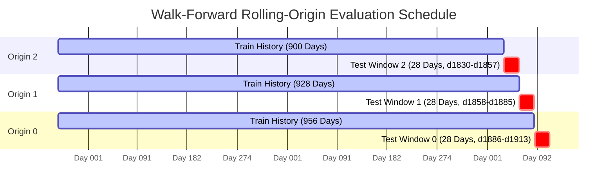
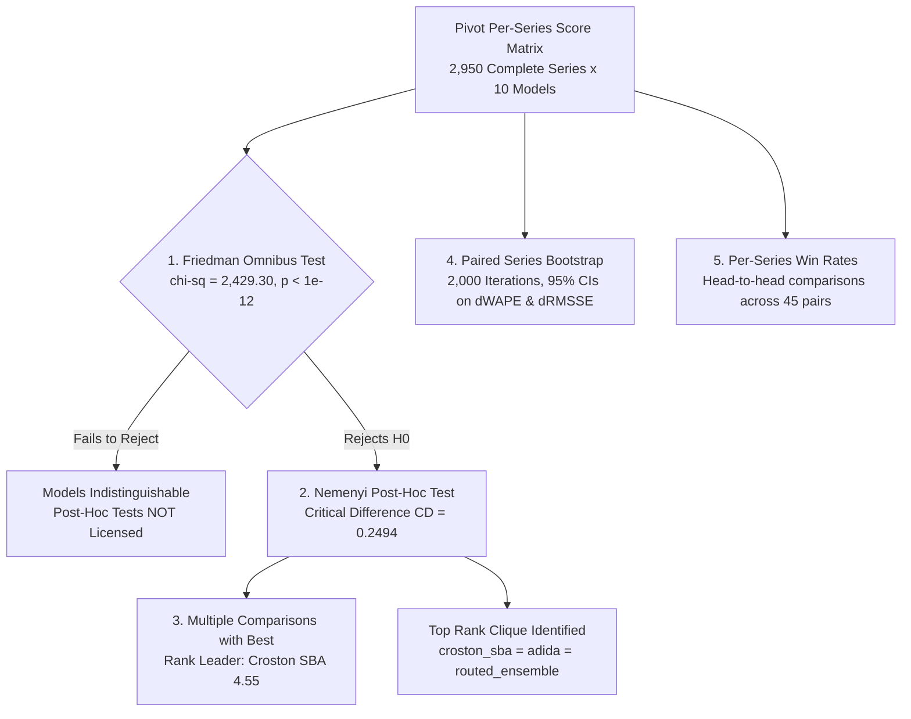

# 04: Evaluation Protocol, Statistical Methodology, & Falsification Gates

This document defines the rigorous experimental protocol, walk-forward backtesting framework, metrics, statistical testing battery, and the specific conditions that would falsify every empirical claim made by the platform.

---

## 1. Experimental Protocol: Walk-Forward Rolling-Origin Backtesting

Static train/test splits (e.g. training on days 1–1885 and testing on days 1886–1913) are vulnerable to temporal anomalies (holidays, promotions, stockouts occurring during that single 28-day window). 

The platform evaluates all models using a **3-origin walk-forward rolling-origin backtest** across a stratified representative sample of **3,000 series** (10 stores $\times$ 3 categories $\times$ 100 items per store-category combination):

- **Origin Count**: 3 rolling origins spaced 28 days apart.
- **Evaluation Window ($h$)**: Exactly 28 days per origin (matching Walmart's monthly replenishment planning cycle).
- **Total Evaluation Days per Series**: $3 \times 28 = 84$ days.
- **Total Prediction Records**: $3,000 \text{ series} \times 84 \text{ days} = 252,000 \text{ predictions per model}$ ($2,520,000$ predictions across the 10-model zoo).
- **Expanding Training Window**: At each origin, historical training data expands by 28 days, emulating real-world monthly model retraining.

---

## 2. Canonical Scale Semantics & Multi-Origin Aggregation

A primary failure mode in published forecasting benchmarks is **scale denominator drift**. In the M5 competition:
$$\text{RMSSE}_{s, o} = \sqrt{\frac{\frac{1}{28}\sum_{t=1}^{28}(y_{s,o,t} - \hat{y}_{s,o,t})^2}{s_{s,o}}}$$
where $s_{s,o}$ is the in-sample naive scale for series $s$ at origin $o$.

### The Two Canonical Rules (Enforced in M5-01):
1. **Per-(Series, Origin) Scaling Before Averaging**:
   Because the training history expands by 28 days between origins, in-sample naive variance $s_{s,o}$ changes at each origin for 99.9% of series. RMSSE must be scaled per (series, origin) using that origin's own scale before averaging across origins:
   $$\text{RMSSE}_s = \frac{1}{|O_s|}\sum_{o \in O_s} \text{RMSSE}_{s,o}$$
   $$\text{Panel Mean RMSSE} = \frac{1}{S}\sum_{s=1}^S \text{RMSSE}_s$$
   Grouping all 84 predictions across origins together before dividing by a single scale inflates or deflates RMSSE by up to 14%.
2. **Catalog-Wide Launch Anchor**:
   Pre-launch zero trimming is anchored to Day 1 ($d_1$) of the full catalog history. If a product launched on Day 100, its naive scale in a window starting on Day 900 does not trim the zeros at Day 900–930, because those zeros represent active low demand, not pre-launch inactivity.

---

## 3. The 10-Model Benchmark Zoo

The benchmark systematically compares 10 models spanning statistical baselines, intermittent estimators, gradient-boosted trees, and dynamic segment ensembles:

| Model ID | Model Name | Model Family | Description & Conditioning |
| :--- | :--- | :--- | :--- |
| `naive` | Naive Random Walk | Baseline | Persistence forecast: $\hat{y}_{t+h} = y_t$ (last observed value). |
| `seasonal_naive` | Seasonal Naive (28d) | Baseline | 28-day lag persistence: $\hat{y}_{t+h} = y_{t+h-28}$. |
| `seasonal_naive_weekly` | Seasonal Naive (Weekly) | Baseline | Day-of-week persistence: $\hat{y}_{t+h} = y_{t+h-7}$. |
| `moving_average` | Moving Average (28d) | Baseline | Rolling mean of the most recent 28 observed active days. |
| `ses` | Simple Exponential Smoothing | Classical Statistical | Exponentially weighted average with optimized alpha parameter. |
| `croston_sba` | Croston SBA | Intermittent Statistical | Debiased Syntetos-Boylan approximation separating demand size and interval. |
| `adida` | ADIDA | Intermittent Statistical | Temporal aggregation into multi-day buckets, SES forecast, and uniform disaggregation. |
| `lightgbm` | LightGBM (L2) | Global Machine Learning | Global gradient-boosted decision trees optimizing Mean Squared Error. |
| `lightgbm_tweedie` | LightGBM (Tweedie) | Global Machine Learning | Global GBDT optimizing Tweedie compound Poisson deviance ($\rho = 1.1$). |
| `routed_ensemble` | Routed SBT Ensemble | Hybrid Segment Router | Categorizes series via SBT; routes sparse series to ADIDA and smooth to LightGBM. |

---

## 4. Statistical Testing Battery

To prevent declaring winners from random sampling fluctuations, the platform executes a 4-tier statistical testing protocol:

### 1. Omnibus Friedman Test
- **Null Hypothesis ($H_0$)**: All 10 forecasting models perform with equal rank across the 2,950 complete series.
- **Empirical Statistic**: $\chi_F^2 = 2429.30$, degrees of freedom $df = 9$, $p < 10^{-12}$.
- **Decision**: Decisively rejected. Post-hoc testing is rigorously licensed.

### 2. Nemenyi Post-Hoc Critical Difference
- **Formula**: $CD = q_{0.05} \sqrt{\frac{k(k+1)}{6N}} = 0.2494$.
- **Finding**: Average ranks:
  - `croston_sba`: **4.554** (Rank Leader)
  - `adida`: **4.768** (Gap to best: $+0.214 < CD$) -> **Same Clique as Best**
  - `routed_ensemble`: **4.794** (Gap to best: $+0.240 < CD$) -> **Same Clique as Best**
  - `ses`: 4.911 (Gap: $+0.357 > CD$) -> Significantly worse
  - `moving_average`: 4.935 (Gap: $+0.381 > CD$) -> Significantly worse
  - `lightgbm_tweedie`: 5.378 (Gap: $+0.824 > CD$) -> Significantly worse
  - `lightgbm`: 5.557 (Gap: $+1.003 > CD$) -> Significantly worse

### 3. Paired Series Bootstrap (95% CIs)
Resampling 2,950 entire series blocks with replacement 2,000 times yields paired metric differences relative to ADIDA (the volume-weighted WAPE champion):
- `adida`: $\Delta\text{WAPE} = +0.00\%$ (reference)
- `routed_ensemble`: $\Delta\text{WAPE} = +0.50\%$, 95% CI: **[-0.01%, +1.04%]**. Because 0 is inside the 95% confidence interval, the Routed Ensemble is **statistically indistinguishable from ADIDA on WAPE**.
- `moving_average`: $\Delta\text{RMSSE} = +0.0011$, 95% CI: **[-0.0001, +0.0023]**. Moving average is **statistically indistinguishable from ADIDA on RMSSE**.
- `lightgbm_tweedie`: $\Delta\text{WAPE} = +2.10\%$, 95% CI: [+1.40%, +2.84%] (separable).

### 4. Per-Series Head-to-Head Win Rates
Evaluating models series-by-series resolves the apparent contradiction between Nemenyi ranks and pooled WAPE:
- `croston_sba` vs. `adida`: Croston SBA wins on **56.97%** of series, while ADIDA wins on **42.87%** of series (0.17% ties).
- **The Finding**: Croston SBA is consistently slightly better on thousands of low-volume sparse series (which dominates equal-weighted rank metrics), whereas ADIDA achieves lower absolute error on high-volume items (which dominates volume-weighted aggregate WAPE).
- Furthermore, under Holm-corrected per-series Diebold-Mariano tests, the two models are statistically indistinguishable on **93.80% of series**.

---

## 5. What Would Falsify Each Core Claim

A scientific engineering claim is only meaningful if it specifies the exact empirical conditions that would falsify it:

| Project Claim | How It Could Be Falsified | Verification Test in Repo |
| :--- | :--- | :--- |
| **"ADIDA matches or outperforms LightGBM on intermittent retail series"** | If LightGBM achieves statistically superior WAPE on sparse series, or if the 95% bootstrap CI on $\text{WAPE}_{\text{LightGBM}} - \text{WAPE}_{\text{ADIDA}}$ is strictly negative ($< 0$). | Check that $\Delta\text{WAPE}$ CI is $[+1.40\%, +2.84\%]$ in `reports/backtest_main/significance/bootstrap_intervals.csv`. |
| **"Croston SBA, ADIDA, and Routed Ensemble form a top indistinguishable clique"** | If the gap in average ranks between Croston SBA and ADIDA or Routed Ensemble exceeds $CD = 0.2494$ at $\alpha=0.05$. | Check that $|\bar{R}_{\text{croston}} - \bar{R}_{\text{adida}}| = 0.214 \le 0.2494$ in `significance_report.json`. |
| **"Feature engineering contains zero temporal leakage"** | If any lag feature uses actual sales from $t - 27$ to $t$ to forecast horizon days $t+1 \dots t+28$. | `src/features/polars_engine.py:assert_no_temporal_leakage()` raises `AssertionError` if maximum training timestamp overlaps evaluation periods. |
| **"Releasing capital by cutting service levels on tail SKUs raises total annual cost"** | If the capital-release rule did not raise holding plus expected stockout cost under the project's cost model (shortage = $\sigma_L G(z) \times 365/L \times$ unit margin). | Verified in `reports/inventory/policy_comparison.csv`: the rule releases $3,170 of working capital but changes total annual cost by +$12,444/yr; on the 90/95/98% menu 98% is cheapest in every optimised segment (-$18,684/yr). |
| **"Results are 100% reproducible from a clean git clone"** | If running `pytest -q` or `python scripts/render_readme_tables.py --check` on a fresh clone produces any failure or table diff. | Fresh clone check runs in an isolated temp directory and passes with 0 failures and green render check. |
